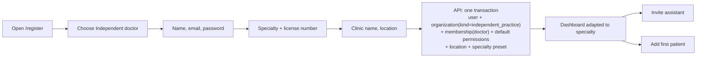
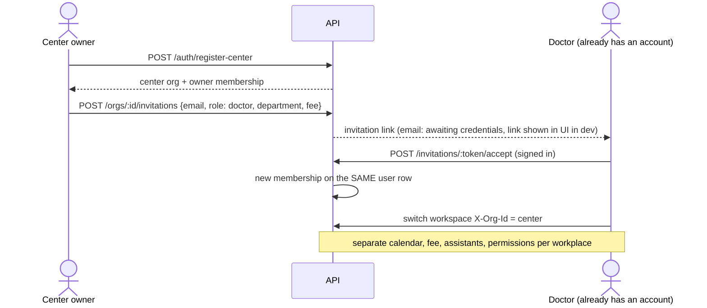
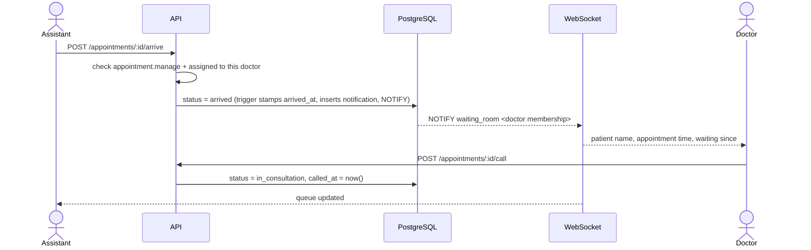
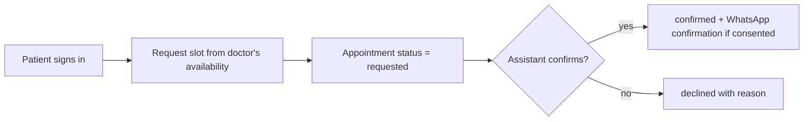
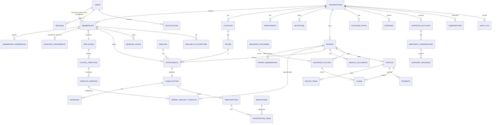
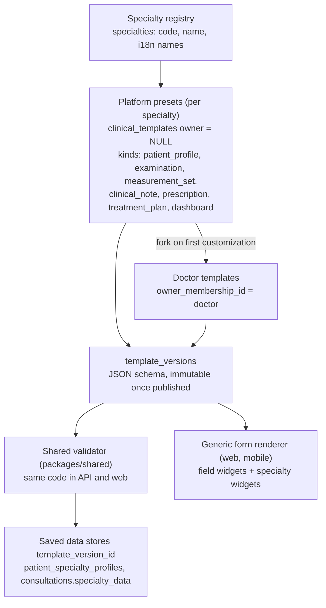

# MEDORA CLINICS: Architecture deliverables (blueprint section 20)

Version 1.0, 25 November 2026. Source of truth: the MEDORA product blueprint (kept in the project files, not in this repository).
Diagrams are Mermaid and render in GitHub, VS Code and most Markdown viewers.

Contents
1. Product architecture diagram
2. Platform sitemap
3. User journey diagrams
4. User role and permission matrix
5. Database entity relationship diagram
6. Specialty engine architecture
7. Web application structure
8. Mobile application structure
9. Brand identity and design system (see also `brand/`)
10. Technical implementation plan

Status words used everywhere in this project: **Implemented**, **Tested**, **Awaiting credentials**, **Planned**.

---

## 1. Product architecture diagram

One API, one database, several clients. Every client is a thin layer over the same REST + WebSocket API, so the web app, PWA and the three native apps share one source of truth and one permission model.

```mermaid
flowchart TB
  subgraph Clients
    WEB["Web app + PWA<br/>Next.js, React, TS, Tailwind"]
    DOC["Doctor app<br/>Expo / React Native"]
    AST["Assistant app<br/>Expo / React Native"]
    PAT["Patient app + portal<br/>Expo / Next.js route group"]
    SADM["Super Admin console<br/>Next.js route group, separate host"]
  end

  subgraph API["MEDORA API (NestJS, Node 22)"]
    GW["HTTP gateway<br/>auth guard, tenant guard, permission guard, rate limit"]
    WS["WebSocket gateway<br/>waiting room, notifications"]
    subgraph Modules
      AUTH[Identity & sessions<br/>MFA, recovery]
      ORG[Organizations<br/>memberships, invites, staff]
      PERM[Permissions<br/>roles, per-member grants]
      SPEC[Specialty engine<br/>templates, versions, renderer schema]
      PATM[Patients<br/>profile, search, duplicates, linking]
      APPT[Scheduling<br/>calendar, availability, waiting room]
      CLIN[Clinical<br/>consultations, Rx, documents]
      FIN[Finance<br/>invoices, payments, USD/LBP, expenses]
      INS[Insurance<br/>providers, policies, claims, NSSF]
      COMM[Communication<br/>WhatsApp, email, SMS, automations]
      RPT[Reports & exports]
      BILL[Subscriptions & plans]
      AUD[Audit]
    end
    JOBS["Job runner<br/>reminders, exports, webhooks"]
  end

  subgraph Data
    PG[("PostgreSQL 16<br/>row-level security per tenant<br/>append-only audit log")]
    OBJ[("Object storage<br/>encrypted, signed URLs")]
    SEC[("Secrets store<br/>WhatsApp tokens, keys")]
  end

  subgraph External["External (each needs credentials)"]
    META[Meta WhatsApp Cloud API]
    MAIL[Email provider]
    SMS[SMS provider]
    PAY[Payment gateways]
  end

  WEB & DOC & AST & PAT & SADM --> GW
  WEB & DOC & AST --> WS
  GW --> Modules
  Modules --> PG
  CLIN & INS --> OBJ
  COMM --> SEC
  PG -- "LISTEN/NOTIFY" --> WS
  JOBS --> PG
  JOBS --> META & MAIL & SMS
  META -- webhooks --> GW
  FIN --> PAY
```



Key rules the architecture enforces:
- **Backend and database both check access.** The API checks the permission; PostgreSQL row-level security (RLS) checks the tenant and clinical confidentiality again. The frontend only hides what the user can't use.
- **One account per person.** A doctor is one `users` row with many `memberships` (one per workplace), each with its own role, fee, calendar, assistants and permissions.
- **Active workspace.** Each request names one organization (header `X-Org-Id`). The API verifies the membership, then opens a transaction with `app.user_id` and `app.org_id` set, which is what RLS reads.
- **Clinical confidentiality inside a tenant.** A center admin is in the tenant but does not see consultation notes, diagnoses or prescriptions unless they have the explicit `clinical_notes.read` grant.

---

## 2. Platform sitemap

Hosts: `app.` (staff web + PWA), `my.` (patient portal), `admin.` (MEDORA Super Admin). In development they are route groups of one Next.js app.

```
Public
├── /                      Landing (brand, plans)
├── /login                 Sign in (+ MFA step)
├── /register              Choose: Independent doctor | Medical center
├── /register/doctor       Profile, specialty, license, clinic profile
├── /register/center       Center profile, first location, owner account
├── /invite/:token         Accept invitation (doctor / assistant / staff)
└── /recover               Account recovery

Staff workspace  (/w/:orgId/...)  workspace switcher in the top bar
├── dashboard              Role-aware: doctor / assistant / center admin / accountant
├── calendar               Day | Week | Month, per doctor, location, room
├── appointments/new       Create, walk-in, recurring
├── waiting-room           Live queues per doctor and department
├── patients               Search (name, phone, patient ID), duplicates
│   ├── new
│   └── :patientId         Patient file
│       ├── overview       Timeline (all events, chronological)
│       ├── profile        Personal info, emergency contact, ID, insurance
│       ├── specialty      Specialty sections (growth chart, dental chart, ...)
│       ├── consultations  [R2]
│       ├── prescriptions  [R2]
│       ├── documents      [R2]
│       ├── appointments
│       └── billing        Invoices, payments [R3]
├── consultations/:id      Consultation workspace [R2]
├── finance                Overview, invoices, payments, expenses, rates [R3]
├── insurance              Providers, policies, claims [R3]
├── inbox                  WhatsApp inbox [R4]
├── reports                Clinical, financial, center analytics [R3/R6]
└── settings
    ├── profile            My name, language, MFA
    ├── workspace          Clinic / center profile
    ├── locations-rooms
    ├── departments        (centers)
    ├── team               Members, invites, assistant assignment
    ├── permissions        Per-member permission switches
    ├── specialty          My templates, custom fields, versions
    ├── services           Services, durations, prices
    ├── availability       Working hours, breaks, holidays
    └── automations        Reminder timing, language, templates [R4]

Patient portal  (my.)
├── appointments           Request, view, request change
├── prescriptions          Only shared + issued
├── documents              Only shared
├── profile
└── notifications          Preferences, opt-out

Super Admin  (admin.)
├── doctors | centers | users     Search, suspend
├── plans                         Prices and limits
├── subscriptions | trials | payments
├── specialty-presets             Platform templates per specialty
├── usage                         Platform metrics
├── support                       Support requests
└── config                        Global configuration
```

---

## 3. User journey diagrams

### 3.1 Independent doctor onboarding (Release 1)



### 3.2 Medical center onboarding and inviting an existing doctor



### 3.3 Arrival to consultation (live waiting room)



### 3.4 Patient requests an appointment (portal, Release 4/5)



---

## 4. User role and permission matrix

Roles give a **default** permission set. When a membership is created the defaults are copied into `membership_permissions`, and from then on each permission is a switch the doctor (for their assistants) or the center owner/admin (for center staff) can turn on or off individually. `prescription.create` can only ever be held by a doctor membership (database trigger), whatever the switches say.

Legend: ● default on, ○ can be granted, — never.

| Permission | Super admin | Center owner | Center admin | Doctor | Assistant | Receptionist | Accountant | Insurance admin | Patient |
|---|---|---|---|---|---|---|---|---|---|
| org.manage (profile, locations, rooms, departments) | — | ● | ● | ● own practice | — | — | — | — | — |
| staff.manage (invite, assign, suspend) | — | ● | ● | ● own assistants | — | — | — | — | — |
| permission.manage | — | ● | ● | ● own assistants | — | — | — | — | — |
| patient.register | — | ○ | ● | ● | ● | ● | — | — | — |
| patient.file.read (demographics) | — | ○ | ● | ● | ● | ● | ○ | ○ | own |
| patient.history.read (medical history, specialty data) | — | ○ | ○ | ● | ○ | — | — | — | own, shared |
| clinical_notes.read (consult notes, Dx) | — | ○ | ○ | ● own patients | ○ | — | — | — | — |
| appointment.manage | — | ○ | ● | ● | ● | ● | — | — | request only |
| prescription.view | — | ○ | ○ | ● | ○ | — | — | — | own, shared |
| prescription.create | — | — | — | ● | — | — | — | — | — |
| document.upload | — | ○ | ○ | ● | ● | ○ | — | ○ | — |
| payment.register | — | ○ | ○ | ● | ○ | ● | ● | — | — |
| finance.view | — | ● | ○ | ● own | ○ | — | ● | ○ | — |
| insurance.manage | — | ○ | ○ | ● | ○ | — | ○ | ● | — |
| whatsapp.send | — | ○ | ○ | ● | ○ | ○ | — | — | — |
| report.view | — | ● | ● | ● own | ○ | — | ● | ○ | — |
| template.manage (specialty customization) | — | — | — | ● | — | — | — | — | — |
| platform.* (plans, tenants, presets) | ● | — | — | — | — | — | — | — | — |

Scope rules on top of the switches:
- **Assistant** permissions apply only to the doctors they are assigned to (`assistant_assignments`). An assistant of Dr A in the center cannot see Dr B's calendar.
- **Doctor** clinical access covers patients linked to them (`patient_memberships`). Linking another doctor of the same center to a patient is an explicit, audited action.
- **Super admin** works on platform tables (tenants, plans, subscriptions, presets). They have no read access to any tenant's patient data by default; support access is a time-boxed, audited grant (Planned R6).
- **Patient** sees only rows flagged `shared_with_patient` and issued prescriptions.
- Every create, update, status change, permission change, login and export writes to the append-only `audit_log`.

---

## 5. Database entity relationship diagram

Existing migrations: `db/001_core.sql`, `db/002_modules.sql`. Release 1 adds `003_release1_foundation.sql` (sessions, MFA, recovery, invitations, role defaults, specialty profiles, cross-tenant foreign keys) and `004_tenant_isolation.sql` (row-level security). The diagram shows the main entities; lookup tables (roles, permissions, payment methods, plans) are omitted for space.



Tenant isolation design (implemented in `004_tenant_isolation.sql`, tested by `db/rls_test.js`):
- The API connects as role `medora_app`, which is **not** the table owner and has no `BYPASSRLS`. RLS is enabled on every tenant table, so every query from the API is filtered. Only migrations run as the owner.
- Each transaction runs `SET LOCAL app.user_id` and `app.org_id`. Policies call `medora_is_member(org)`, a `SECURITY DEFINER` function that checks for an active membership of that user in that org, so a forged `app.org_id` without a membership sees nothing.
- Tables with `organization_id` use it directly. Child tables (rooms, consultations, prescriptions, invoice items, payments, ...) are visible only when their parent row is visible.
- Composite foreign keys stop cross-tenant references: an appointment's patient and doctor membership must belong to the appointment's organization; same for invoices.
- Clinical tables (consultations, diagnoses, prescriptions, prescription items) add a second condition: the user is the treating doctor, an assistant assigned to that doctor with the right grant, or holds `clinical_notes.read`.

---

## 6. Specialty engine architecture

Goal: a new specialty is data, not code. The engine has four layers.



**Template schema** (version 1 of the format):

```json
{
  "format": 1,
  "sections": [
    { "key": "birth", "label": {"en":"Birth history","ar":"تاريخ الولادة","fr":"Antécédents de naissance"},
      "fields": [
        { "key": "gestational_age_weeks", "type": "number", "min": 20, "max": 45, "unit": "weeks" },
        { "key": "birth_weight_kg", "type": "number", "min": 0.3, "max": 7, "unit": "kg", "required": true },
        { "key": "delivery", "type": "select", "options": ["vaginal","c_section"] }
      ] },
    { "key": "growth", "widget": "growth_chart", "fields": [ ... ] }
  ]
}
```

Field types: `text`, `textarea`, `number` (min, max, unit, step), `date`, `boolean`, `select`, `multiselect`, `computed` (age from DOB, EDD from LMP, BMI), and `repeat` (a list of rows, e.g. vaccinations, pregnancies). Specialty widgets are named renderers over ordinary fields: `growth_chart` (pediatrics), `dental_chart` (FDI tooth numbering, dentistry), `body_map` (orthopedics, dermatology), `vitals_trend` (cardiology). Unknown widgets fall back to the plain field list, so an older client never breaks.

**Customization:** a doctor's change (add a custom field, hide an optional field, rename a label) creates their own template forked from the preset, as a new draft version; publishing locks it. Records saved under version 1 keep pointing at version 1 and render with it. Required preset fields can't be removed, only optional ones.

**Workspace adaptation:** the dashboard asks `GET /specialty/workspace`, which returns the active templates for the doctor's membership (profile sections, measurement set, dashboard widgets). The UI is driven by that response, not by `if (specialty === ...)` branches.

**Release 1 scope:** registry with 16 specialties (7 with full presets, 9 prepared with the general-practice base), presets for patient profile sections, doctor customization with versioning, validated patient specialty profile, and specialty dashboard widgets. Examination forms inside consultations use the same engine in Release 2.

---

## 7. Web application structure

```
medora/
├── db/migrations/            001 ... 004 SQL, applied in order by db/migrate.js
├── packages/shared/          TypeScript: permission codes, role defaults,
│                             template schema types + validator, status machine
├── apps/api/                 NestJS
│   └── src/
│       ├── main.ts           bootstrap, cookies, CORS, WS adapter
│       ├── db/               pg pool, withTenant(tx) helper (sets app.user_id/org_id)
│       ├── common/           guards: AuthGuard, TenantGuard, Permission decorator
│       ├── auth/             register doctor/center, login, MFA (TOTP), sessions, logout
│       ├── orgs/             workspaces, locations, rooms, departments
│       ├── staff/            invitations, memberships, assistant assignment, permissions
│       ├── specialty/        registry, templates, versions, workspace config
│       ├── patients/         CRUD, search, duplicate detection, linking, specialty profile
│       ├── scheduling/       services, working hours, exceptions, appointments, availability
│       ├── waiting-room/     queue, arrive/call, WebSocket gateway (LISTEN/NOTIFY)
│       ├── notifications/
│       └── audit/
│   └── test/                 e2e tests against a real PostgreSQL
└── apps/web/                 Next.js App Router + Tailwind
    └── src/
        ├── app/(public)/     login, register, invite
        ├── app/w/[orgId]/    staff workspace pages (see sitemap)
        ├── components/ui/    design-system components (Button, Field, Card, Table, Badge, ...)
        ├── components/specialty/   form renderer + specialty widgets
        ├── lib/api.ts        typed fetch client, cookie session
        ├── lib/i18n/         en, ar, fr dictionaries; dir="rtl" for Arabic
        └── app/manifest.ts   PWA manifest; service worker (Planned R5)
```

Request path: browser → Next.js page → `lib/api.ts` → API (cookie `medora_session`, header `X-Org-Id`) → guards → service → `withTenant()` transaction → PostgreSQL with RLS.

---

## 8. Mobile application structure

Release 5. Responsive web and installable PWA come first (Release 1 lays the layout and manifest). Native apps are one Expo monorepo app with three role-gated shells, or three thin apps over a shared package; the decision is taken at Release 5 based on store requirements.

```
apps/mobile/
├── app/(auth)/               sign-in, MFA, workspace picker
├── app/(doctor)/             today, waiting room, patient file, consult, Rx, follow-ups, finance summary
├── app/(assistant)/          calendar, arrivals, waiting room, register patient, inbox
├── app/(patient)/            appointments, requests, prescriptions, documents, profile, notifications
├── src/api/                  same typed client as web (packages/shared)
├── src/push/                 Expo push tokens → API /devices (Awaiting credentials: APNs/FCM)
└── src/offline/              read cache for today's schedule (no offline writes for clinical data)
```

Shared with web: API, authentication (bearer token variant of the same session), permission codes, template schema and validator, i18n dictionaries, design tokens.

---

## 9. Brand identity and design system

Full tokens and logo files: `architecture/brand/`. Summary:

**Logo.** The MEDORA Care logo adapted for Clinics: a cross of four rounded squares (dark teal above and below, light teal at the sides) around a coral circle, the patient at the centre. Wordmark "Medora" in rounded dark teal (Quicksand Bold outlines), with "CLINICS" letter-spaced in light teal beneath. Files: `brand/medora-logo.svg` (light backgrounds), `brand/medora-logo-dark.svg` (dark backgrounds), `brand/medora-mark.svg`, `brand/medora-app-icon.svg`. Logo colours are fixed: `#115D62`, `#1B9AA7`, `#EE6C5E`.

**Colour.**

| Token | Light | Dark | Use |
|---|---|---|---|
| `brand` | `#115D62` dark teal | `#2FB0BC` | Primary actions, active nav |
| `brand-2` | `#1B9AA7` light teal | `#5CC6D0` | Secondary brand, the logo's side squares and "CLINICS" |
| `brand-ink` | `#0B1B2B` | `#E7EEF2` | Headings, body text |
| `accent` | `#EE6C5E` coral | `#F2877A` | Highlights, the logo's centre circle, waiting-room attention |
| `surface` | `#F5F7F6` | `#0A141C` | App background |
| `card` | `#FFFFFF` | `#111E28` | Cards, panels |
| `line` | `#E2E8E6` | `#22313C` | Borders |
| `success` | `#2F9E6A` | `#46C08A` | Completed, paid |
| `warning` | `#C98A12` | `#E3AE3F` | Waiting long, outstanding |
| `danger` | `#C8413A` | `#E26A62` | Cancelled, errors |
| `info` | `#3B6FD8` | `#7CA2F0` | Confirmed, links |

Appointment status colours are fixed across web and mobile: scheduled grey, confirmed info, arrived accent, waiting warning, in consultation brand, completed success, cancelled and no-show danger.

**Type.** Latin: Inter (UI) with "Plus Jakarta Sans" for display headings. Arabic: IBM Plex Sans Arabic. Scale 12 / 14 / 16 / 18 / 22 / 28 / 36. Numbers use tabular figures in tables and finance.

**Layout and components.** 4 px spacing grid, 12 px radius on cards, 10 px on inputs and buttons. Left sidebar navigation on desktop, bottom tab bar on mobile. Components: Button (primary, secondary, ghost, danger), Field (label, hint, error), Select, Card, Stat tile, Table, Badge (status), Tabs, Dialog, Toast, Empty state. Icons: one outline icon set, 1.75 px stroke.

**Language and direction.** Each user picks English, Arabic or French. Arabic sets `dir="rtl"` on the document; layout uses logical CSS properties (`ms-`, `me-`, `ps-`, `pe-`) so it mirrors without separate styles.

**Modes.** Light and dark mode from the same tokens (CSS variables), following the system setting with a manual override.

---

## 10. Technical implementation plan

### Principles
- Real database, real authentication, real permission checks from the first commit. No mock buttons: a control that isn't backed by a working endpoint is not shown.
- Synthetic data only (`db/seed_synthetic.js`). No real patient data in development.
- Every external integration starts as **Awaiting credentials** and is shown that way in the UI.
- Each module gets automated tests before the next one starts. The development log (`DEVLOG.md`) records each item as Implemented, Tested, Awaiting credentials or Planned.

### Release plan

| Release | Contents | Done when |
|---|---|---|
| **R1 Foundation** | Brand + design tokens, RLS tenant isolation, auth (password, sessions, TOTP MFA), doctor and center registration, memberships and invitations, assistant accounts, permission switches, specialty engine + presets, patients (CRUD, search, duplicates, linking, specialty profile), appointments (calendar, availability, double-booking, statuses, walk-ins), live waiting room with WebSocket | API e2e tests + RLS tests pass; web flows work end to end on synthetic data |
| R2 Clinical | Consultations with specialty exam forms, diagnoses, prescriptions + PDF, documents (object storage), timeline | Rx only by doctor, versioned forms render old records |
| R3 Business | Invoices, payments USD/LBP, expenses, commissions, center accounting, insurance + NSSF claims, financial reports, PDF/Excel export | Balances and rates reconcile in tests |
| R4 Communication | WhatsApp Cloud API (per-number credentials), templates, reminders 24h/2h, inbox, consent/opt-out, email/SMS | Works in Meta sandbox with real test number |
| R5 Mobile | PWA service worker, Expo doctor/assistant/patient apps, push | Store test builds |
| R6 Commercial | Super Admin, plans, trials, subscriptions, usage limits, support access | Plan limits enforced in API |
| R7 Launch | Security, tenant isolation, permission, performance, backup and mobile testing; UAT; production | External penetration test; no compliance claims without assessment |

### Environments and operations
- Local: PostgreSQL 16, Node 22, `npm run dev` for API (port 4000) and web (port 3000).
- Config only through environment variables (`DATABASE_URL`, `APP_DATABASE_URL`, `SESSION_SECRET`, `WEB_ORIGIN`, ...). Secrets never in the repo.
- Planned before production: CI (lint, typecheck, tests on every push), managed PostgreSQL with point-in-time recovery and tested restores, object storage with server-side encryption, error tracking, uptime monitoring, TLS everywhere.

### Testing strategy
- **Database:** `db/smoke_test.js` (schema rules) and `db/rls_test.js` (tenant isolation: cross-tenant reads, writes and references must fail as `medora_app`).
- **API:** e2e tests with a real database: registration, login, MFA, workspace switching, permission denial, assistant scope, appointment conflicts, arrival notification over WebSocket.
- **Web:** typecheck and production build; Playwright flows planned for R7.
